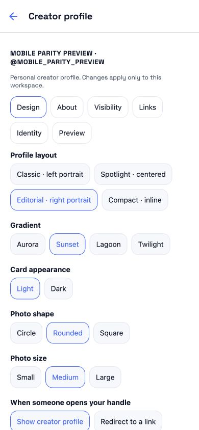
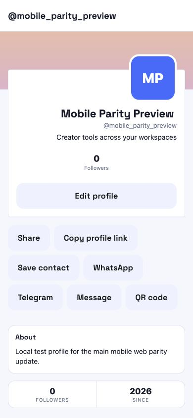

# Main mobile web parity update — 24 October 2026

## Scope and evidence

The target is `artifacts/1inme-mobile` (main Expo/React Native app), with supporting changes in the shared Laravel API. The standalone dialer is not modified. This review includes older modules and navigation, not only the latest creator-profile commits. The companion JSON inventories screen sources, API clients and drawer destinations. A file or route being present is source coverage, not proof of every provider, plan or device flow working.

## Delivered changes

| Area | Previous gap | Update |
|---|---|---|
| Navigation | Existing capabilities labelled with hard-coded Soon; Leads pointed to no screen; AI Staff client had no screen | Added native Feed, Leads, Buzz, Pixels, Chat Widgets, AI Staff and creator Monetization screens. Payouts uses its existing native screen. Drawer uses server feature availability for supported destinations. All 65 native drawer destinations resolve. |
| Web-only tools | Disabled placeholders and outdated AI Note Summarizer naming | Attendance (newly merged PR #595), AI Planner, AI Minds, advanced AI Agents and Task Boards are explicitly labelled Web and open verified web routes. Removed the obsolete, unresolved AI Link Optimizer destination. A browser sign-in may be needed; no token is copied into a URL. |
| Workspace switching | Local workspace could change before a failed API switch; persisted local selection could disagree with server | Server-first activation, server-reported active workspace on startup/refresh, all query modules invalidated after switching. Activation updates request/session context as well as persisted ID. |
| Creator editor | Missing newer web layout/theme/destination controls; all fields in one long form | Categorized Design, About, Visibility, Links, Identity and Preview tabs; four layouts, four gradients, light/dark cards, avatar size/shape, selected main biolink, direct redirect, publish, bio/tagline/location. |
| Creator identity | Avatar gallery used personal account endpoint; creator form had no workspace handle action | Workspace profile ID guards, workspace creator avatar endpoint/gallery, dedicated handle claim with existing banned-name/uniqueness validation and identity-change warning. Personal name editing remains in account settings; workspace creator name uses workspace profile. |
| Images | Creator avatar/cover source choices were inconsistent with web | URL, upload and paginated My Files choices; restore account photo or gradient. Verified avatar lock is retained. Image controls save immediately; other form controls save through Save changes. |
| Preview | Only the personal settings screen exposed the signed preview | Shared preview component, cache keyed by active workspace; loads the actual saved public page, not an invented card. |
| Public creator profile | Hidden posts still requested/rendered; paid actions ignored visibility | Suppress feed requests, post header/count/empty state when hidden; API returns empty hidden feed and filters paid posts when monetization is hidden. Native presentation uses chosen palette/portrait position; verification has a colored circled check and thin strip. Selected biolink and redirect URLs respect custom domains. |
| Verification | Native form lacked richer evidence and active-workspace scope | Select verification type, additional information, supporting URLs and image/PDF attachments. Optional workspace context keeps existing personal API callers compatible. Workspace request histories and state are separate. |
| Phone ownership | Exclusive workspace caller identity and disputes existed only on web | Native attach verified number, list allocations/claims, request admin ownership review with message, URLs and attachments. Shared identity service retains global number exclusivity and admin-only reassignment. Login identifiers remain separate. |
| Sharing | Native creator profile lacked newer share/contact actions | Share sheet, copy, contact vCard, WhatsApp, Telegram, SMS and QR dialog. Public profile respects sharing visibility. |
| Links | List/grid only indicated disabled status | Accessible enable/disable control using existing update API, server result/refetch, error handling and no optimistic false success. Existing editor toggle remains. |
| Tracking pixel scope | API defaulted to the first workspace and permitted generic members | Native requests include the selected workspace ID; shared API reads/writes enforce `pixels.view` / `pixels.edit`. |
| Older pairings | Web added URL/file pairings but native fell back to generic Create | Dedicated short-link/file create routes and icons; free-plan mapping guard updated to the actual web catalog. |
| Accessibility | New radio/tab selections and shared action buttons lacked explicit web semantics | Checked/selected ARIA states and shared button roles/labels/disabled state; real browser snapshot confirms selected controls. |

## Existing older modules inspected in the source inventory

The main app already has native screen families and API clients for links/biolink editors and appearance, QR/NFC, analytics/visitors, contacts/dialer, inbox/notifications, forms/subscribers, calendar/events, restaurant/store, service booking, accounting/invoices/expenses/recurring/catalog/tax/ledger, billing/plans/coins, projects/delivery/client portals, vault/files, social, brand kits/studio, AI coaching/marketing, security/sessions/connected IDs, workspaces and teams. These were not rebuilt or blanket-certified. Navigation validation and the mobile unit suite exercise parts of these older integrations.

The existing `parity:check-mobile-docs` guard reports 12/129 web block types with an explicit static mobile editor catalog entry and 24/24 documented link types. That guard measures the curated static catalog, not every specialized editor branch or public renderer in the large mobile biolink implementation. Its passing result does not mean 129 complete native editors.

## API compatibility

- Existing `/me/creator-profile` reads/writes remain compatible. Owner payload adds profile/workspace identity, image URLs, presentation and destination settings. PATCH accepts presentation/destination/image fields; stale submitted `creator_profile_id` returns 409. Partial presentation changes preserve unrelated showcase settings.
- `POST /me/creator-profile/handle` requires the active `creator_profile_id` and a valid handle.
- `GET/POST /me/creator-profile/phones`; `POST /me/creator-profile/phone-claims` (optional multipart evidence). All require Sanctum and workspace settings permission; attachment uses the existing verified-identifier registry and shared admin queue.
- `/profile-verification` accepts `context=workspace` and optional profile ID guard; absence retains personal account scope. Multipart `proof_files[]` uses the existing upload policy.
- `GET /leads?q=&source=&page=` and `POST /leads/decision` expose the shared aggregator/approver, contacts view/edit permissions, existing deduplication/contact-cap rules and 409 for a no-longer-pending lead. They mirror the web aggregator's documented owner-level versus workspace-level source behavior.
- Creator image multipart uses POST with `_method=PATCH`. The client leaves Content-Type to the platform so the multipart boundary is valid. Existing JSON requests retain their JSON header.
- Workspace list adds `is_active`; older consumers can ignore it.

## Validation

Main mobile TypeScript typecheck and the complete `test:unit` chain passed. The focused PostgreSQL suite passed 19 tests / 75 assertions, including creator settings, stale workspace writes, hidden feeds, verification invalidation/scope, phone exclusivity, leads and pixel workspace/role isolation. Route-shadowing and mobile/docs parity guards passed. Android and iOS JavaScript/Hermes exports passed. Expo browser checks exercised a saved handle change and presentation save/reload at 390 × 844. These are local checks, not store deployment. A supplementary run of the 13 newly merged attendance tests had no assertion failures but reported seven existing output-buffer warnings; it is not counted as a clean suite pass here. Tests use isolated local PostgreSQL databases; no production user data, messages, financial transactions or staff records were changed. The Expo browser preview uses a disposable local fixture account. Physical iOS/Android testing, signed store builds, provider checkout, S3-backed upload/download and biometric/NFC hardware are not certified by these checks.

## Remaining limits

- This is a broad compatibility update, not a claim of complete native equivalence for every web control or block type. The five explicitly marked web tools still use the browser; advanced provider/admin operations and specialized web block editing may also remain web-only.
- Native Buzz supports listing/creation and metrics; it does not replace the full web campaign editor. Chat Widgets supports creation/listing from enabled personas; full training/provider configuration stays on web. AI Staff supports toggles and manual suggestion review; authoring/chase/chat remains on web. Monetization adds owner totals/tier visibility, not a new native tier editor.
- Mobile phone and verification uploads are implemented against the production upload contract, but the isolated local environment has no configured S3 provider. Native gallery/document permissions, physical camera/files and real provider uploads need device/provider validation.
- PR #595 added the web attendance implementation while this audit was underway. The main mobile menu now exposes it as Web; native attendance capture and vendor biometric integration are not implemented in this PR.
- A new mobile build/update and deployment of the shared API changes are required before these changes reach installed apps.

## Browser proof (disposable local account)

