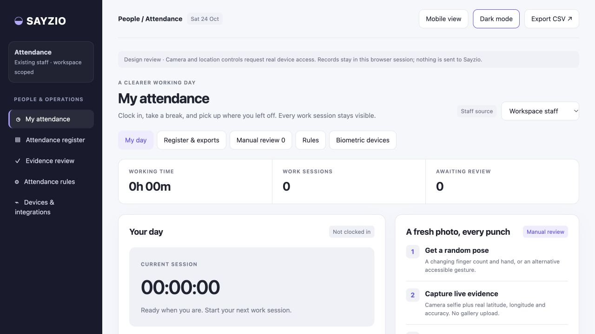
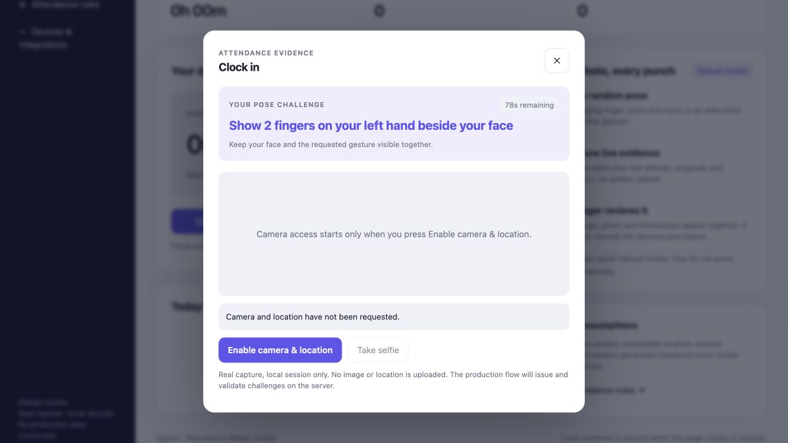

# Attendance design review

The app implementation is documented in [Attendance](../../attendance.md), including workspace and internal staff routes. The standalone design below remains a local-only prototype.

From the repository root, run `python3 -m http.server 8789 --bind 127.0.0.1 --directory docs/designs`, then open http://127.0.0.1:8789/attendance/. Camera and location require browser permission and a supported secure context (localhost or HTTPS).

This is the design-first deliverable, not a deployed attendance system. The staff-source selector shows workspace and internal admin contexts; it does not connect either staff directory.

## Working in this design

- Desktop/mobile layouts and light/dark themes.
- Random finger-count/hand challenges, with an alternative gesture option and expiry.
- Real browser camera and GPS requests, triggered only by the person's explicit action. No gallery uploader or invented coordinates/photos.
- Local-session clock-ins/outs, multiple work sessions, breaks and working-time calculation.
- Manual evidence review showing the actual captured photo, issued pose, capture/punch timestamps, coordinates and accuracy; decisions require notes.
- CSV export of actual local records and browser print/save PDF.
- Explicit empty/offline/not-connected states; no sample attendance or device punches.

## Production implementation still required

- Authenticated staff/workspace assignments and granular permissions.
- Server-issued single-use challenges bound to staff, workspace and attendance action; secure upload storage, server receipt timestamps, expiry/replay protection and audit history.
- Persistent punch/session/review records and robust shift, timezone, overnight, duplicate and offline handling.
- Geofence policies, correction/leave/overtime approvals, retention and payroll exports.
- Brand/model-specific biometric adapters with authenticated device mapping and retry deduplication.
- Optional automatic checkout must remain a system-generated event without fabricated image/location evidence.

The local camera/GPS flow has not been exercised against the user's physical camera or location. Closing/reloading the page discards records and photos. Browser session times and challenges are demonstrative client values, not trusted attendance assertions. No automated liveness or face matching is claimed.
